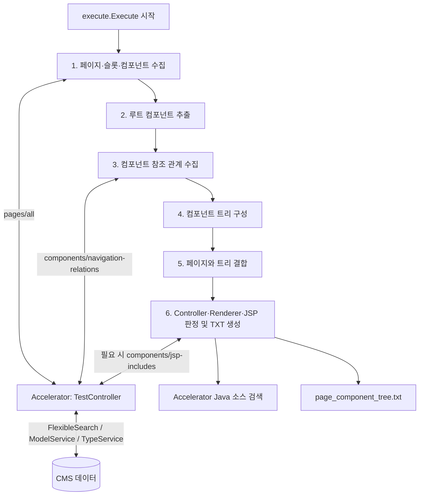

# CMS-ANALYZER 작동 흐름

- 작성 기준일: 2026-11-18
- 대상 프로젝트: `C:\Users\krist\git\start202610pj\javaTool\cms-analyzer`
- 기준: Controller·Renderer·JSP 판정 기능을 추가한 현재 소스 코드
- 상세 알고리즘: [cms-analyzer-algorithm.md](cms-analyzer-algorithm.md)

## 1. 목적과 구성

CMS-ANALYZER는 페이지와 슬롯에 연결된 CMS 컴포넌트를 수집하고, 컴포넌트의 참조 관계를 따라 트리를 구성한다. 각 컴포넌트에 Controller 또는 Renderer 판정 결과와 JSP 정보를 덧붙여 `page_component_tree.txt`로 출력한다.

| 구성 요소 | 실행 위치 | 역할 |
|---|---|---|
| `execute.Execute` | 분석기(실행 클래스) | 6단계 실행 순서 제어, 단계별 오류 전달 |
| 각 `Exporter` 및 `PageSlotComponentExporter` | 분석기 | HTTP 조회, CSV 저장·결합, 트리 구성·출력 |
| `ComponentRenderingResolver` | 분석기 | Java 파일명 검색, Renderer 설명 매핑, PK별 JSP 정보 결합 |
| `TestController` | Accelerator storefront | CMS 데이터를 조회하는 HTTP API 제공 |
| `FlexibleSearchService` | Accelerator | 페이지·슬롯·JSP 속성 조회 |
| `ModelService` / `TypeService` | Accelerator | 컴포넌트 모델 및 참조 속성 조사 |

분석기에서 DB에 직접 접속하는 구조가 아니다. CMS 데이터는 Accelerator의 `TestController`를 통해 가져오고, Controller Java 파일은 분석기에서 접근할 수 있는 로컬 소스 폴더에서 찾는다.

## 2. 전체 처리 흐름

Mermaid를 지원하지 않는 Markdown 뷰어에서는 아래 단계와 파일 목록으로 같은 흐름을 확인할 수 있다.

## 3. 6단계 실행

| 단계 | 실행 클래스 | 입력 | 출력 |
|---|---|---|---|
| 1 | `PageSlotComponentExporter` | `TestController.getAllPages()` 응답 | `page_slot_component.csv` |
| 2 | `RootComponentsExporter` | `page_slot_component.csv` | `root_components.csv` |
| 3 | `ComponentRelationsExporter` | `TestController.getNavigationRelations()` 응답 | `component_relations.csv` |
| 4 | `ComponentTreeExporter` | 루트 CSV + 관계 CSV | `component_tree.csv`, `warnings.csv` |
| 5 | `PageComponentTreeExporter` | 페이지·슬롯 CSV + 트리 CSV | `page_component_tree.csv` |
| 6 | `PageComponentTextTreeExporter` | 결합 CSV + Java 소스 + 필요 시 JSP API | `page_component_tree.txt` |

표의 파일은 전체 실행 시 작업 디렉터리의 `output` 폴더에 생성된다.

### 3.1 페이지·슬롯·컴포넌트 수집

`PageSlotComponentExporter`가 `/cms-analyzer/pages/all`을 호출한다. `TestController.getAllPages()`는 `SQL_FILE`에 지정된 FlexibleSearch문을 읽고 실행하여 JSON을 반환한다.

제공된 SQL은 `Online` 페이지의 페이지 전용 슬롯, 템플릿 슬롯, 슬롯이 없는 페이지를 수집한다. 페이지 슬롯과 위치가 겹치는 템플릿 슬롯에는 `OVERRIDDEN`을 표시하며, 해당 슬롯도 결과에 남긴다.

### 3.2 루트 컴포넌트 추출

슬롯에 직접 연결된 컴포넌트를 루트로 취급한다. 빈 PK는 제외하고, PK 기준으로 중복을 제거하여 `root_components.csv`에 저장한다.

### 3.3 참조 관계 수집

`TestController.getNavigationRelations()`는 페이지 조회를 다시 수행하여 시작 PK를 수집한다. 컴포넌트 모델의 읽기 가능한 참조 속성을 조사하고, 참조된 컴포넌트를 큐에 추가한다.

NavigationNode가 발견되면 하위 노드와 NavigationEntry도 조사한다. Entry가 CMS 컴포넌트를 가리키면 현재 컴포넌트와 그 대상 사이의 관계를 기록한다. 각 컴포넌트는 PK 기준으로 한 번 조사한다.

### 3.4 컴포넌트 트리 구성

루트별로 깊이 우선 탐색하여 트리 행 ID, 부모 행 ID, 깊이, PK 경로와 상태를 기록한다. 현재 조상 경로를 다시 참조하면 순환 경고를 남기고 그 연결로의 탐색을 중단한다.

같은 컴포넌트가 서로 다른 경로에서 사용되면 각 경로에 표시한다.

### 3.5 페이지와 트리 결합

페이지·슬롯 행의 컴포넌트 PK와 트리의 루트 PK를 연결한다. 공유 트리도 각 페이지·슬롯 위치에 맞추어 결합한다.

| 결합 상태 | 의미 |
|---|---|
| `MATCHED` | 컴포넌트 트리와 결합됨 |
| `NO_COMPONENT` | 슬롯에 연결된 컴포넌트가 없음 |
| `TREE_NOT_FOUND` | 컴포넌트 PK는 있지만 대응하는 트리가 없음 |

### 3.6 Controller·Renderer·JSP 추가 및 TXT 생성

소스 폴더에서 Controller Java 파일을 한 번 검색하여 인덱스를 만든다. 각 컴포넌트에 아래 규칙을 적용하고 페이지 → 슬롯 → 컴포넌트 구조로 출력한다. 템플릿 슬롯은 PageTemplate 아래에 배치한다.

## 4. Controller와 Renderer 판정 규칙

아래 7개 타입은 `Controller=なし`와 함께 지정된 Renderer 설명을 출력한다.

| TypeCode | Renderer 설명 |
|---|---|
| `CMSParagraphComponent` | cmsParagraphComponentRenderer「直書き」 |
| `CMSLinkComponent` | cmsLinkComponentRenderer「直書き」 |
| `ImageMapComponent` | imageMapComponentRenderer「直書き」 |
| `AssistedServiceComponent` | AssistedServiceComponentRenderer 「cms/asm/assistedServiceComponent.jsp(条件付き)」 |
| `ProductAddToCartComponent` | B2BAcceleratorProductAddToCartComponentRenderer 「未確認」 |
| `ReorderAction` | DefaultAddOnCMSComponentRenderer 「未確認」 |
| `ApproveOrderAction` | DefaultAddOnCMSComponentRenderer 「未確認」 |

그 외 타입은 `<componentType>Controller.java` 파일명을 대소문자 구분 없이 검색한다.

- 0개: `DefaultCMSComponentController`
- 1개: 발견한 Controller 이름 및 소스 경로
- 여러 개: `MULTIPLE_MATCHES` 및 후보 경로 전체
- 타입이 비어 있음: `[COMPONENT_TYPE_MISSING]`

이는 파일명 규칙에 따른 판정이다. Spring 설정이나 실제 요청 실행 경로를 분석하지 않는다.

## 5. JSP 판정 규칙

| 조건 | 출력 |
|---|---|
| `JspIncludeComponent`이고 해당 PK의 `page` 값이 있음 | `JSP=<page 값>` |
| 해당 PK의 조회 행이 없음 | `JSP=[JSP_INCLUDE_NOT_FOUND]` |
| 조회된 `page`가 null 또는 공백 | `JSP=[JSP_PATH_EMPTY]` |
| 다른 모든 타입 | `JSP=[jsp個別確認必要]` |

처음 `JspIncludeComponent`가 등장할 때 `/cms-analyzer/components/jsp-includes`를 한 번 호출한다. 서버는 JspIncludeComponent의 PK·UID·page를 일괄 조회하고, 분석기는 현재 컴포넌트의 PK로 결과를 연결한다. 중첩 컴포넌트와 반복 사용된 컴포넌트에도 같은 규칙을 적용한다.

## 6. TestController의 API

다음 경로는 storefront 및 사이트 경로 뒤에 붙는 Controller 매핑이다.

| 경로 | 메서드 | 동작 |
|---|---|---|
| `/cms-analyzer/ping` | `ping()` | `CMS_ANALYZER_OK` 반환. Runner에서는 호출하지 않음 |
| `/cms-analyzer/pages/all` | `getAllPages()` | SQL 파일로 페이지·슬롯·컴포넌트 조회 |
| `/cms-analyzer/components/navigation-relations` | `getNavigationRelations()` | 루트부터 컴포넌트·Navigation 참조 관계 수집 |
| `/cms-analyzer/components/jsp-includes` | `getJspIncludes()` | JspIncludeComponent의 PK·UID·page 일괄 조회 |

## 7. 오류 처리와 결과 보존

- 한 단계에서 예외가 발생하면 Runner는 다음 단계로 진행하지 않는다.
- Controller 소스 폴더가 없거나 Controller Java 파일이 하나도 없으면 오류로 중단한다.
- JSP API의 HTTP 오류, JSON 파싱 오류, 잘못된 행, 중복 PK는 오류로 처리한다.
- 최종 TXT는 임시 파일 작성을 마친 뒤 교체한다. 교체 전 조회·검증·작성 오류가 발생하면 기존 TXT는 유지된다.
- 전체 6단계를 묶어 되돌리는 기능은 없다. 앞 단계에서 저장한 CSV는 남을 수 있다.

## 8. 설정과 현재 확인 사항

| 항목 | 현재 값 또는 설정 방법 |
|---|---|
| Controller 검색 루트 | `-Dcms.analyzer.sourceRoot=...`, 기본 `C:/hybris/bin` |
| JSP 조회 URL | `-Dcms.analyzer.jspUrl=...` |
| JSP 기본 URL | `https://localhost:9002/mmmstorefront/mmm-faec/ja/JPY/cms-analyzer/components/jsp-includes` |
| Host 헤더 | `mmm-faec.local:9002` |
| Host 헤더 허용 옵션 | `-Djdk.httpclient.allowRestrictedHeaders=host` |
| 실행 Java | Java 21 이상 |

JSP URL 설정은 새 JSP API에만 적용된다. 기존 페이지·관계 조회 URL은 각 클래스의 상수로 유지되어 있다. HTTPS 실행에는 환경에 맞는 기존 truststore 설정이 필요하다.

현재 소스에는 다음 환경 의존 항목이 남아 있다.

1. `TestController.SQL_FILE`은 `C:\Users\h-jang\javaTools\cms-analyzer` 기준 경로다. 배포 환경의 SQL 경로를 확인해야 한다.
2. 프로젝트에 포함된 SQL은 18개 컬럼을 반환하지만 `getAllPages()`는 `pageTemplatePk`를 포함한 19개 컬럼을 기대한다. 실제 사용 SQL의 컬럼 수와 순서를 맞춰야 한다. 현재 SQL을 그대로 연결하면 조회 결과 매핑 과정에서 오류가 발생할 수 있다.
3. 수정된 `TestController`를 Accelerator에 반영하고 재시작해야 새 JSP API를 사용할 수 있다.

분석기 컴파일과 로컬 테스트는 통과했다. 실제 Accelerator와 DB를 연결한 전체 실행은 검증하지 않았다. 이 문서는 현재 구현의 작동 흐름을 설명하며, 위 불일치 항목을 수정한 것으로 간주하지 않는다.
